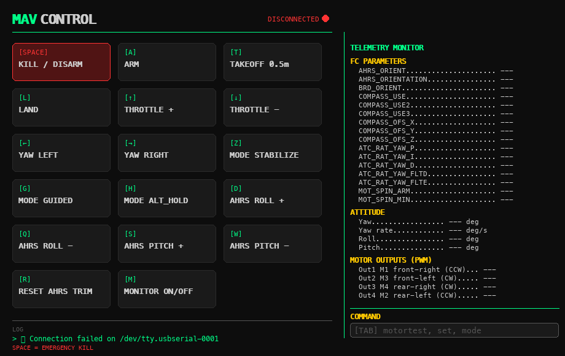

# pixhawk-drone — F450 quadcopter on a Pixhawk PRO, flown from a laptop

Companion repository of the project page: **https://how2222.github.io/portfolio/projects/drone.html**

A 450-class quadcopter built from parts between January and April 2026: F450 frame, Pixhawk PRO running
ArduCopter 4.6.3 (fmuv3 build), A2212 motors with 30 A ESCs, a 3S 3000 mAh LiPo, a Raspberry Pi 4 as
companion computer, and no RC transmitter — the drone is flown from a MacBook over a pair of SiK 433 MHz
telemetry radios with the program in this repository.

## Contents

| File | What it is |
|---|---|
| `mavcontrol.py` | Keyboard ground-control program (Python + pygame + pymavlink): arm / disarm, take-off, land, throttle, flight modes, AHRS trim, live telemetry monitor and a small command line (`motortest`, `set`, `mode`, `reboot`). |
| `raspberry-pi.md` | How the Raspberry Pi 4 is linked to the flight controller over TELEM 2 (UART, MAVLink 2, MAVProxy). |
| `requirements.txt` | Python dependencies of `mavcontrol.py`. |

## Running the ground-control program

```bash
python3 -m venv venv && source venv/bin/activate
pip install -r requirements.txt
python3 mavcontrol.py --port /dev/tty.usbserial-0001 --baudrate 57600
```

`--port` is the SiK ground radio plugged into the laptop (57 600 baud by default). Keys are listed in the
window; `Space` is the emergency kill (force disarm). `M` opens the telemetry monitor, where `Tab` gives a
command line.


